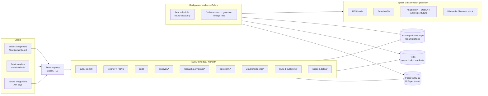

# Architecture — Janaki AI Newsroom

Status: **Phase 0 plan + Phase 1 implemented.** Sections marked *(planned)* are not yet built.

## 1. Current-state assessment (Phase 0 audit)

| Item | Finding (14 Nov 2026) |
|---|---|
| Existing repository | None. Workspace contained only the master project prompt. |
| Starter ZIPs / prior code | None supplied. If any exist elsewhere, they must be audited before Phase 2 to avoid duplicate work. |
| Existing schema / migrations | None. |
| Existing Janaki TV website | Not available for inspection. Migration plan (Phase 7) requires access to its CMS export, URL list and media. |
| Environment | Python 3.13, Node 22, PostgreSQL 16, Redis 7 available. Docker CLI present but no daemon in the build sandbox. |

Conclusion: greenfield build. No code is being replaced.

## 2. Architectural style

A **modular monolith** (one FastAPI deployable, strict internal module boundaries) plus **independent background workers** that share the same codebase and database. This fits the ₹5–8k/month budget (one small VPS) while keeping modules extractable later.

Rules that keep it extractable:

1. Each module (`app/modules/<name>`) owns its tables, models, services and router.
2. Modules talk to each other through service functions, never by importing another module's ORM internals for writes.
3. Long-running or external work (fetching, AI calls, image processing) always runs in a worker, never in a request.
4. Every tenant-owned table has `tenant_id` + PostgreSQL row-level security.

## 3. System diagram



`*` = planned (Phases 2–8). Phase 1 delivers auth, tenancy, RBAC, API keys and audit.

## 4. Key technical decisions

| Decision | Choice | Why |
|---|---|---|
| Web framework | FastAPI + Pydantic v2 | Typed contracts, auto OpenAPI. |
| ORM / DB access | SQLAlchemy 2 (sync) + psycopg 3 | Sync sessions run in FastAPI's threadpool; simpler transaction control for RLS `SET LOCAL`. Revisit async only if profiling demands it. |
| Migrations | Alembic, run by a separate DB **owner** role | The runtime **app** role is non-superuser, `NOBYPASSRLS`, and does not own tables, so RLS is genuinely enforced. |
| Tenant isolation | App-level scoping **and** PostgreSQL RLS keyed on `app.tenant_id` (transaction-local) | Defence in depth: a forgotten `WHERE tenant_id` returns nothing instead of leaking. |
| Queue | Celery + Redis | Mature beat scheduler, retries, routing by queue (cheap vs expensive AI jobs). |
| Sessions | 15-min JWT access token + rotating opaque refresh token stored hashed in `auth_sessions` | Revocable (logout, password change, deactivation), no CSRF exposure for bearer APIs. The Next.js app will hold the refresh token in an httpOnly, SameSite=Strict cookie via its own server route (BFF). |
| Password hashing | Argon2id | Current OWASP recommendation. |
| MFA | TOTP (RFC 6238), required for tenant admins and platform admins (configurable) | No SMS cost, works offline. |
| AI | Provider-independent gateway; models chosen by config per task tier | No hard-coded model names; cheap models for classification, stronger for writing. |
| Object storage | S3-compatible (MinIO locally; any India-region S3-compatible service in prod) | Tenant prefix `tenants/<tenant_id>/…`, signed URLs only. |
| Frontend | Next.js + TypeScript + Tailwind, next-intl for ne/en | Requirement; built from Phase 6. |
| Reverse proxy | Caddy | Automatic HTTPS with minimal config. |

## 5. Request lifecycle and tenant context

```mermaid
sequenceDiagram
    participant C as Client
    participant A as FastAPI dependency chain
    participant DB as PostgreSQL (app role)
    C->>A: Authorization: Bearer <JWT> or X-API-Key
    A->>A: verify signature / hash, extract tenant_id from *server-issued* credential
    A->>DB: BEGIN; SELECT set_config('app.tenant_id', <id>, true)
    A->>DB: verify session/key still active (RLS-filtered)
    A->>A: build Principal (user or api key, permissions)
    A->>DB: handler queries — RLS filters every tenant table
    A->>DB: COMMIT (context is transaction-local, cannot leak to pooled connection)
```

A tenant ID in a URL or body is **never** used to set context. It is only compared with the principal's tenant.

The only code path that may set `app.bypass_rls = on` is `app.db.session.system_scope()`, used for: credential resolution before the tenant is known (login, API-key lookup, refresh), and platform-admin operations. Each use is listed in SECURITY.md.

## 6. Repository structure

```
janaki-ai-newsroom/
├── README.md
├── docker-compose.yml          # dev: postgres, redis, minio, api, worker
├── .env.example
├── docs/                       # the 12 required documents
├── backend/
│   ├── Dockerfile
│   ├── pyproject.toml
│   ├── alembic.ini
│   ├── alembic/versions/       # migrations (owner role)
│   ├── app/
│   │   ├── main.py             # app factory, routers, error handlers
│   │   ├── core/               # config, security primitives, errors, permissions
│   │   ├── db/                 # engine, session, tenant context, base model
│   │   ├── api/                # deps (auth → Principal), v1 routers
│   │   └── modules/
│   │       ├── tenancy/        # Phase 1
│   │       ├── identity/       # Phase 1: users, roles, sessions, MFA, API keys
│   │       ├── audit/          # Phase 1
│   │       ├── discovery/      # Phase 2 (planned)
│   │       ├── research/       # Phase 3 (planned)
│   │       ├── editorial/      # Phase 4 (planned)
│   │       ├── ai_gateway/     # Phase 4 (planned)
│   │       ├── visuals/        # Phase 5 (planned)
│   │       ├── cms/            # Phase 7 (planned)
│   │       └── billing/        # Phase 8 (planned)
│   ├── scripts/                # bootstrap platform admin, seed Janaki TV
│   └── tests/
└── frontend/                   # Next.js (Phase 6)
```

## 7. Planned module designs (summary)

- **Discovery (P2):** source registry (approved domains only) → `safe_fetch` (DNS-pinned, private-IP blocking, redirect re-validation, size/time limits) → normalise → fingerprint (canonical URL hash + SimHash of title/lead) → cluster into `news_events` using entities, dates, locations and embeddings (pgvector, tenant-scoped). Celery beat enqueues one job per tenant per hour with an idempotency key `discovery:<tenant>:<yyyy-mm-ddThh>`.
- **Research (P3):** claims extracted by a cheap model into strict JSON schema; each claim linked to `evidence` rows (supports / contradicts / context). Status is computed by rules from evidence (e.g. ≥2 independent publishers supporting, none contradicting → *corroborated*), never from model self-reported confidence.
- **Editorial (P4):** an angle planner proposes Article A (straight) and Article B (context) and must cite evidence IDs per paragraph; a distinctness check (semantic similarity threshold + required unique evidence) decides whether B is produced. Language versions generated per angle; a consistency checker compares extracted entities/numbers across ne/en and flags mismatch.
- **Visuals (P5):** licence-first image adapters; `publishable` is a DB-computed flag requiring commercial-use + licence URL + attribution. AI illustrations carry an immutable `ai_generated` label.
- **CMS (P7):** separate public read path serving only `published` rows; drafts never reachable without auth; publish is idempotent via `publishing_records(article_version_id)` unique key.
- **Billing (P8):** usage ledger written by the AI gateway and workers; hard caps checked before enqueueing expensive jobs.
