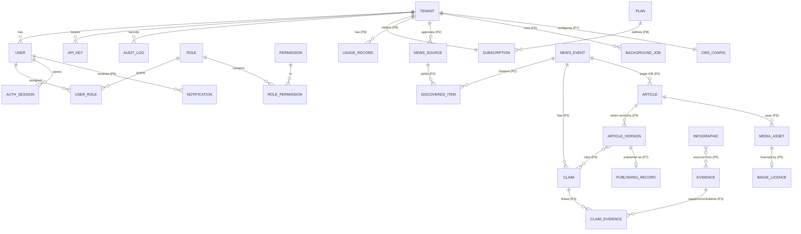

# Database Schema

PostgreSQL 16. All primary keys are UUIDs (except `audit_logs`, which uses `bigint` identity for ordering). All timestamps are `timestamptz`, stored in UTC.

## 1. Database roles

| Role | Purpose | Properties |
|---|---|---|
| `janaki_owner` | Owns schema; runs Alembic migrations only | Table owner (RLS does not apply to it by default) |
| `janaki_app` | Runtime role for API and workers | `NOSUPERUSER NOBYPASSRLS`, DML grants only; **no UPDATE/DELETE on `audit_logs`** |

## 2. Tenant isolation

Every tenant-owned table has `tenant_id` and an RLS policy:

```sql
USING (
  tenant_id = nullif(current_setting('app.tenant_id', true), '')::uuid
  OR current_setting('app.bypass_rls', true) = 'on'
)
```

Settings are applied with `set_config(..., true)` (transaction-local), so a pooled connection cannot carry a previous request's tenant. Rows with `tenant_id IS NULL` (platform users, platform sessions, platform audit entries) are visible only under the system bypass.

## 3. Phase 1 tables (implemented — migration `0001_saas_foundation`)

| Table | Key columns | RLS | Notes |
|---|---|---|---|
| `tenants` | `slug` (unique), `name`, `status` (`active`/`suspended`), `default_language`, `settings` jsonb | No (accessed only via platform-admin endpoints or the authenticated tenant's own row) | Root of isolation |
| `users` | `tenant_id` (NULL = platform user), `email` (lower-cased), `password_hash` (Argon2id), `kind` (`human`/`service`), `is_platform_admin`, `is_active`, `mfa_secret_enc`, `mfa_enabled`, `failed_login_count`, `locked_until` | Yes | Unique `(tenant_id, email)`; partial unique on `email` where `tenant_id IS NULL` |
| `permissions` | `key` PK, `description` | No (global catalogue) | Seeded from code |
| `roles` | `key` (unique), `name`, `is_system` | No | System roles: `tenant_admin`, `editor`, `reporter`, `reviewer` |
| `role_permissions` | `role_id`, `permission_key` | No | Seeded |
| `user_roles` | `tenant_id`, `user_id`, `role_id` | Yes | PK `(user_id, role_id)` |
| `auth_sessions` | `tenant_id`, `user_id`, `refresh_token_hash`, `expires_at`, `revoked_at`, `ip`, `user_agent` | Yes | Refresh tokens stored as SHA-256 only; rotated on every refresh |
| `api_keys` | `tenant_id`, `name`, `prefix` (unique), `secret_hash` (HMAC-SHA256 with server pepper), `scopes` text[], `expires_at`, `revoked_at`, `rotated_from_id` | Yes | Plaintext shown once at creation |
| `audit_logs` | `tenant_id`, `actor_type`, `actor_id`, `action`, `target_type`, `target_id`, `ip`, `details` jsonb | Yes | Append-only for the app role |

## 3b. Phase 2 tables (implemented — migration `0002_news_discovery`)

| Table | Key columns | RLS | Notes |
|---|---|---|---|
| `news_sources` | `kind` (rss/search), `feed_url`, `search_query`, `allowed_domains[]`, `language`, `country`, `region`, `category`, `priority`, `credibility`, `is_enabled`, `last_error`, `consecutive_failures` | Yes | App role has no DELETE: disable instead, so provenance stays traceable |
| `discovered_items` | `source_id`, `event_id`, `job_id`, `url`, `canonical_url`, `url_hash` (unique per tenant), `publisher_domain`, `title`, `description`, `published_at`, `retrieved_at`, `content_fingerprint`, `title_simhash` | Yes | One row per article URL; never merged away |
| `news_events` | `title`, `keywords[]`, `title_simhash`, `status`, `item_count`, `publisher_count`, `first_seen_at`, `last_seen_at` | Yes | Groups items about the same story |
| `background_jobs` | `job_type`, `idempotency_key` (unique per tenant), `trigger`, `status`, `attempts`, `result` jsonb, `error` | Yes | Job history and idempotency |

## 4. Full planned entity–relationship diagram



## 5. Planned tables by phase (summary)

- **P2:** `news_sources` (allowed domains, feed URL, language, region, category, priority, credibility), `discovered_items` (source_id, url, canonical_url_hash, title, description, published_at, retrieved_at, fingerprint, status), `news_events` (fingerprint, centroid embedding via pgvector, status), `background_jobs` (type, idempotency_key unique per tenant, status, attempts, error).
- **P3:** `claims` (event_id, text, claim_type: fact/reported/official/allegation/opinion/estimate, status), `evidence` (url, publisher, published_at, retrieved_at, excerpt, evidence_type), `claim_evidence` (relationship: supports/contradicts/context).
- **P4:** `articles` (event_id, angle: straight/context, status workflow), `article_versions` (language, headline, alt_headline, slug, summary, body, seo fields, social fields, generated_by, model, created_by), `article_version_claims`.
- **P5:** `media_assets` (storage_key, kind: photo/illustration/chart, ai_generated, publishable — generated column), `image_licences`, `infographics` (data JSON + units + source + date + methodology).
- **P6–P8:** `notifications`, `cms_configs`, `categories`, `tags`, `publishing_records`, `plans`, `subscriptions`, `usage_records` (append-only ledger), `billing_events`.

Indexes: every tenant table has an index leading with `tenant_id`. Unique business keys are always scoped by tenant.
