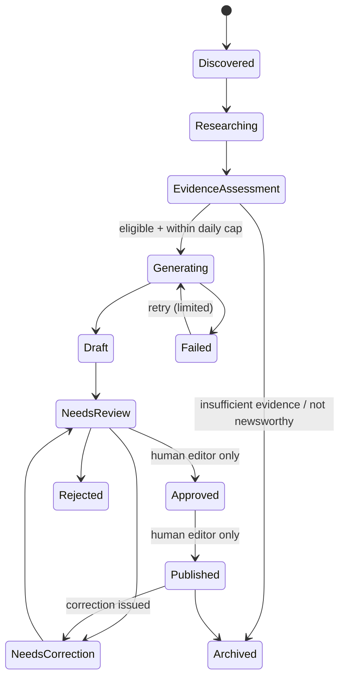

# Editorial Workflow

## Principle

The system assists journalists; it never replaces editorial responsibility. **No AI process, service account or API key can approve or publish an article.** This is enforced in the permission resolver (Phase 1) and will be enforced again by the workflow state machine (Phase 4/7).

## States

Transitions marked *human editor only* require a human user holding `articles.approve` / `articles.publish`.

## Who can do what (system roles)

| Action | Tenant admin | Editor | Reviewer | Reporter | Service account / API key |
|---|---|---|---|---|---|
| Read events & evidence | ✓ | ✓ | ✓ | ✓ | scoped |
| Mark evidence editor-verified | ✓ | ✓ | ✓ | – | – |
| Create / edit drafts | ✓ | ✓ | – | ✓ | create only (scoped) |
| Reject / request correction | ✓ | ✓ | ✓ | – | – |
| Approve | ✓ | ✓ | – | – | **never** |
| Publish | ✓ | ✓ | – | – | **never** |
| Manage users, API keys | ✓ | – | – | – | **never** |

## Two-angle rule

For each eligible event the system proposes Article A (straight report) and Article B (context/impact). B is produced only if it cites evidence not used by A and passes a similarity threshold; otherwise one article is produced with the reason recorded on the event.

## Claim categories shown to editors

Confirmed fact · Reported claim · Official statement · Allegation · Opinion · Estimate · Unverified. Each sentence in a draft links to the claims it relies on; sentences without evidence are highlighted.
